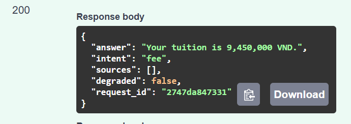

# Lab 4 - Dang

## Work included
- P1-P5 in `lab04/practice/hello_api.py`.
- T1-T4 in `lab04/starter/src/assistant_api/main.py`.
- H1: `OfficeDirectory.all()` returns offices sorted by name; `GET /v1/offices` exposes them as JSON.
- H1 has two API tests: status 200 (including sorted output) and presence of Library.
- H2: [five-line reflection](H2_Dang.md).

## Swagger evidence
Successful `POST /v1/chat` call, status 200:



## Validation
- Lab 4 practice: 5 passed.
- Lab 4 starter: 25 passed, 1 skipped. The skipped test is the optional rate-limit bonus.
- Existing Lab 3 suite: 66 passed.
- Ruff: Lab 4 source and tests checked successfully.
- The supplied curl script was run against a fresh Uvicorn process using this repo's Lab 4 source. All 11 status codes matched the script expectations; live weather returned 200.
- A separate live request to `/v1/offices` returned 200 with all four offices sorted by name, including Library.
- Pytest reports one dependency deprecation warning from Starlette/AnyIO; there were no Lab 4 test failures.

## Running tests
Run each suite from its own directory with Python 3.12 and the Lab 4 requirements installed:

```bash
# Repository root: existing Lab 3 suite
python -m pytest -q

# Lab 4 practice
cd lab04/practice
python -m pytest -q test_hello_api.py

# Lab 4 starter
cd ../starter
python -m pytest -q
```

Root `pyproject.toml` restricts discovery to root `tests/`, avoiding collisions between the independent Lab 3 and Lab 4 packages.
For API setup and curl commands, see [the starter README](../../lab04/starter/README.md).
