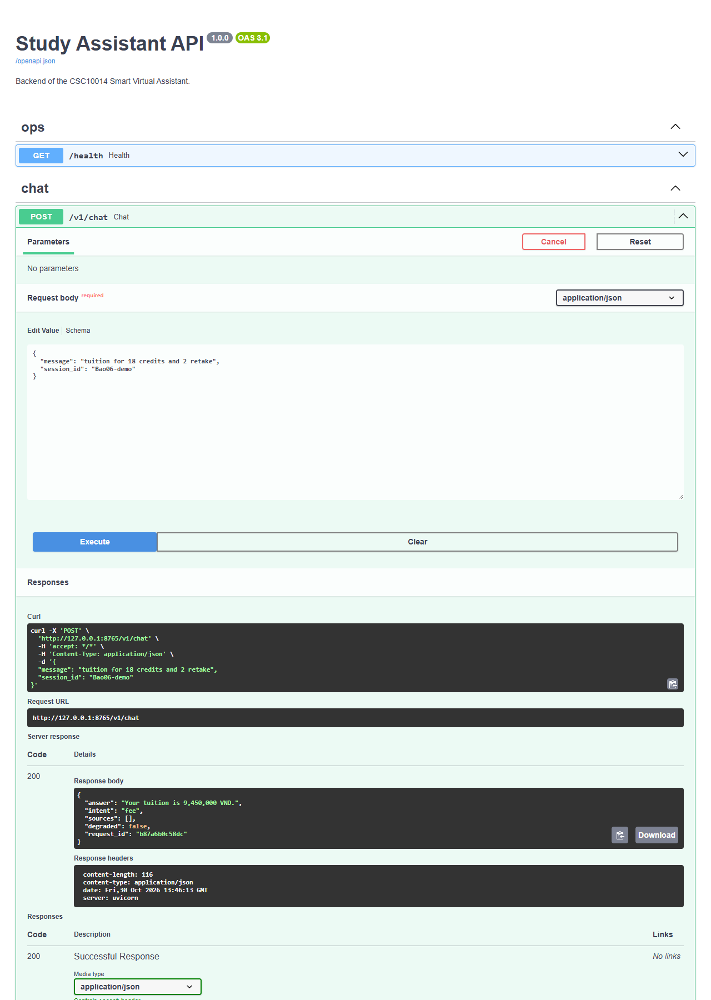

# Lab 4 - bản cá nhân Bảo06 (Rouinz)

Hoàn thành P1-P5 trong `lab04/practice/hello_api.py` và T1-T3 trong `src/assistant_api/main.py`. T4 xử lý lỗi weather thành HTTP 503 đã có trên nhánh nền, được giữ lại và kiểm tra bằng các test weather thành công/lỗi/cache.

## Kiểm tra

Môi trường: Python 3.12.13; cài đúng `lab04/starter/requirements.txt`.

| Phạm vi | Kết quả |
| --- | --- |
| P1-P5 | 5 passed |
| Bộ test Lab 4, gồm ca bổ sung cho T3 | 24 passed, 1 skipped |
| Lab 3 gốc | 66 passed |

Ca rate limit được skip sẵn vì thuộc BONUS. Test T3 bổ sung xác nhận admin có thể đọc danh sách rỗng trước khi có feedback; đường POST tạo feedback không che khuất đường GET.

Từ `lab04/practice`, chạy `python -m pytest -q test_hello_api.py`. Từ `lab04/starter`, chạy `python -m pytest -q`. Từ gốc repository, chạy `python -m pytest -q` để kiểm tra Lab 3. Chạy riêng từng bộ để tránh nạp nhầm hai package cùng tên `assistant_core`.

## Bằng chứng Swagger

Ảnh bên dưới được chụp tại `/docs` của FastAPI chạy trên máy local. Nhấn Try it out và Execute với `tuition for 18 credits and 2 retake`, session `Bao06-demo`; server trả HTTP 200, intent `fee`, học phí `9,450,000 VND` và request_id. Không giả lập response chat. Chi tiết yêu cầu/phản hồi nằm trong `chat-response.json`.

## Giới hạn tích hợp cần review riêng

Nhánh nền `test/Lab04-Rouinz` tại `2721f14fb9f502be0a3ddbd70dbdd2a0ad12b816` có core Lab 4 tách biệt với core gốc. Chạy toàn bộ test Lab 3 trên core Lab 4 cho kết quả 58 passed, 8 failed, do khác biệt có sẵn ở kiểm tra dữ liệu knowledge, tên logger và parse RETAKE viết hoa. PR cá nhân này chỉ hoàn thành P1-P5/T1-T4; các phát hiện đó cần được xử lý khi nhóm thống nhất bản tích hợp. Không dùng kết quả 66 passed của core gốc để khẳng định bản core Lab 4 hoàn toàn tương thích.

H2 gồm 5 dòng nằm trong [H2_Rouinz.md](../H2_Rouinz.md), trình bày sự khác nhau giữa gọi service trực tiếp và gọi qua HTTP, cùng lý do nhóm dùng API.
