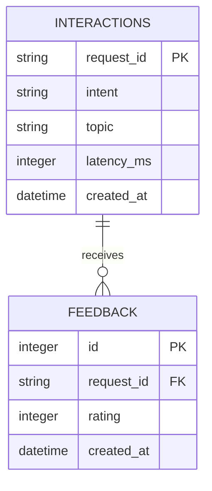

# Lab 5 — Data model worksheet

## 1. Critique the bad schema (sql/bad_schema.sql)
| # | Problem | Why it hurts | Fix |
|---|---|---|---|
| 1 | `id` has no primary-key or uniqueness constraint. | Duplicate or NULL IDs make it impossible to identify a record reliably. | Give every entity a primary key; make `interaction.request_id` unique. |
| 2 | Real names, phone numbers and full messages are stored indefinitely. | They can expose personal details even though the analytics features do not need them. | Omit these fields; store a salted session hash and minimal interaction metadata. |
| 3 | `feedback` stores a comma-separated list. | Individual ratings cannot be reliably validated, joined, timestamped or counted. | Put each rating in a separate `feedback` row, linked to `interaction.request_id`. |
| 4 | `latency` is text such as `120ms`; `time` uses an ambiguous local format. | Numerical averages and chronological sorting become unreliable. | Use numeric `latency_ms` and consistently generated UTC `created_at` timestamps. |
| 5 | Sessions, interactions and feedback are mixed together without foreign keys. | Data is duplicated and feedback can reference no identifiable answer. | Separate `chat_session`, `interaction` and `feedback`; declare their foreign keys and check interaction existence before saving feedback. SQLite foreign-key enforcement must be enabled per connection if relying on database enforcement. |
| 6 | `intent` is uncontrolled free text. | `fee`, `Fee` and `tuition` split one category into misleading groups. | The supplied application derives intent from its router enum. For stronger database protection, add a CHECK constraint or an intent reference table in a future migration; the current schema has neither. |

Additional observations: the bad schema lacks outcome flags (`resolved`, `degraded`), useful topic IDs, and indexes. The supplied design stores these metadata fields and indexes intent, session, creation time and feedback request IDs. Migration 001 constrains ratings to -1/0/1; the API also validates ratings. Tables created directly by SQLModel currently rely on API validation for ratings.

## 2. Store or not? (privacy-aware storage)
| Data | Store? | Form (raw / hashed / aggregated / none) | Retention | Reason |
|---|---|---|---|---|
| raw user message | No | none | Do not persist | May contain personal information; not required for the lab's analytics. |
| session id | Yes, indirectly | salted SHA-256 hash, truncated to 16 hexadecimal characters by the supplied implementation | Proposed: 30 days, then delete session-linked records or retain only aggregate counts | Counts sessions without keeping the original ID; keep the salt secret. Hashes are pseudonymous identifiers and can still link activity. |
| intent, latency, topic | Yes | raw metadata; aggregates for longer-term trends | Proposed: 30 days per interaction, then keep monthly aggregates for 1 year | Supports performance, resolution and topic analysis without raw questions. |
| feedback rating | Yes | one numeric value per feedback row | Proposed: 30 days linked to a request, then aggregate | Measures satisfaction and identifies problematic topics. |
| feedback comment | Optional | raw, at most 500 characters; advise users to omit personal information | Proposed: 30 days, then delete | Can explain a rating, but may itself contain personal details. The starter does not redact comments. |
| student name / phone | No | none | Do not persist | None of the lab features needs these identifiers. |

These retention periods are design proposals, not implemented deletion jobs or requirements stated by the tutorial. When implementing cleanup, remove dependent feedback and interactions before their session records.

## 3. Product questions → fields
| Product question | Fields needed | Table(s) | Query sketch |
|---|---|---|---|
| Most failed intent? | `intent`, `resolved` | `interaction` | `SELECT intent, COUNT(*) AS failures FROM interaction WHERE resolved = 0 GROUP BY intent ORDER BY failures DESC, intent;` |
| Average response time by intent? | `intent`, `latency_ms` | `interaction` | `SELECT intent, ROUND(AVG(latency_ms), 1) AS avg_latency_ms FROM interaction GROUP BY intent ORDER BY avg_latency_ms DESC, intent;` |
| Top unresolved topics? | `topic`, `resolved` | `interaction` | `SELECT topic, COUNT(*) AS unresolved FROM interaction WHERE resolved = 0 AND topic IS NOT NULL GROUP BY topic ORDER BY unresolved DESC, topic;` |

The seed script marks only `unknown` interactions unresolved, and these have NULL topics, so the last query can correctly return no rows on the supplied seed data. Failures can also be compared as percentages when intent volumes differ.

## 4. ER diagram
Completed Mermaid diagram: [../starter/docs/data-model.md](../starter/docs/data-model.md).
### Three main issues required for H3 (PDF p.19)

**Issue 1 — Privacy and retention.** The bad schema stores `student_name`, `student_phone`, and complete messages on every row, without stating when to delete them. A better assistant data model stores only necessary fields (such as a request ID, standardized intent, topic, and timing) and uses a defined retention policy. This reduces unnecessary exposure of personal information.

**Issue 2 — Feedback normalization.** The `feedback` column contains multiple ratings in one string (`'1,-1,1'`). This prevents reliable relational queries and makes it unclear which rating belongs to which request. A better design uses a separate `feedback` table, with a unique feedback ID, a `request_id` foreign key, a constrained rating, and a timestamp. Each rating becomes independently queryable.

**Issue 3 — Consistent, queryable data types.** The schema stores `time` and `latency` as loosely formatted text. A better design stores timestamps in a consistent machine-readable format and latency as a number of milliseconds. This supports chronological sorting and SQL aggregates such as `AVG(latency_ms)`.

## 1. Critique the bad schema (`starter/sql/bad_schema.sql`)

| # | Problem | Why it hurts | Fix |
|---|---|---|---|
| 1 | `id INTEGER` is not declared as a primary key. | Duplicate or missing IDs can make individual chat records difficult to identify and reference reliably. | Use `id INTEGER PRIMARY KEY` and define foreign keys for related records. |
| 2 | `student_name` and `student_phone` are repeated on every chat row. | This duplicates personally identifying information and increases privacy exposure and update inconsistencies. | Do not store names or phone numbers unless necessary; use an opaque session or user identifier with an appropriate retention policy. |
| 3 | Raw `message` and `answer` are stored without any retention policy. | User messages may contain sensitive information, and keeping them indefinitely increases risk. | Minimize stored content; store derived metadata when sufficient, and define deletion/retention rules for any raw text. |
| 4 | `intent` is unrestricted free text (`fee`, `Fee`, `FEE`, `tuition`). | Inconsistent labels split the same intent into different groups, distorting counts and analytics. | Normalize intent values using a controlled vocabulary and application/database validation. |
| 5 | `time TEXT` contains human-formatted timestamps. | Inconsistent formats make chronological sorting, filtering, and time-based aggregation unreliable. | Store a standardized ISO 8601 UTC timestamp or a numeric epoch timestamp. |
| 6 | `feedback TEXT` stores comma-separated ratings such as `1,-1,1`. | This violates the one-value-per-field principle and makes counting, validation, and linking feedback to requests difficult. | Use a separate `feedback` table with one rating per row and a foreign key to the interaction. |
| 7 | `latency TEXT` stores values such as `120ms`. | Numeric calculations such as average latency are unreliable when units are embedded in strings. | Store `latency_ms` as an `INTEGER` or `REAL`, with a nonnegative constraint. |

## 2. Store or not? (privacy-aware storage)

| Data | Store? | Form (raw / hashed / aggregated / none) | Retention | Reason |
|---|---|---|---|---|
| raw user message | Only if necessary and consent/policy permits | raw with access controls, otherwise none | Short, purpose-limited period; delete when no longer needed | May contain sensitive personal data; analytics generally need only derived fields. |
| session id | If needed for session continuity | opaque pseudonymous ID; avoid directly identifying values | Until session expires or the documented retention period ends | Supports request association without storing student names. |
| intent, latency, topic | Yes | normalized labels and numeric milliseconds; aggregate for long-term trends | Per-request records for a limited operational period; aggregate afterward | Supports quality metrics and performance analysis. |
| feedback rating | Yes | constrained integer, one rating per record | Limited operational period; aggregate afterward | Measures answer quality and allows analysis by topic. |
| feedback comment | Only if necessary | raw with access controls, or sanitized/aggregated | Short period; delete when no longer needed | Free-text comments may contain personal information. |
| student name / phone | Normally no for assistant analytics | none | none | Not required for counting intents, latency, or feedback. |

## 3. Product questions → fields

| Product question | Fields needed | Table(s) | Query sketch |
|---|---|---|---|
| Most failed intent? | `intent`, `rating`, `request_id` | `interactions`, `feedback` | `SELECT i.intent, COUNT(*) AS negative_count FROM interactions i JOIN feedback f ON f.request_id = i.request_id WHERE f.rating = -1 GROUP BY i.intent ORDER BY negative_count DESC;` |
| Average response time by intent? | `intent`, `latency_ms` | `interactions` | `SELECT intent, ROUND(AVG(latency_ms), 2) AS avg_latency_ms FROM interactions GROUP BY intent;` |
| Top unresolved topics? | `topic`, `rating`, `request_id` | `interactions`, `feedback` | `SELECT i.topic, COUNT(*) AS negative_count FROM interactions i JOIN feedback f ON f.request_id = i.request_id WHERE f.rating = -1 GROUP BY i.topic ORDER BY negative_count DESC;` |

## 4. ER diagram

