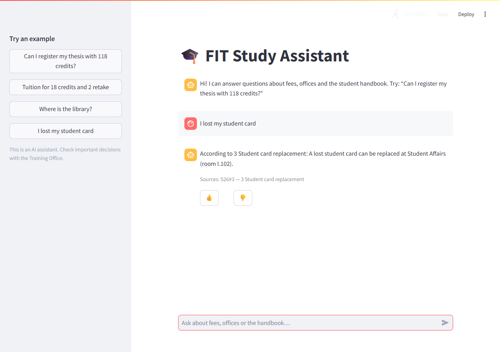
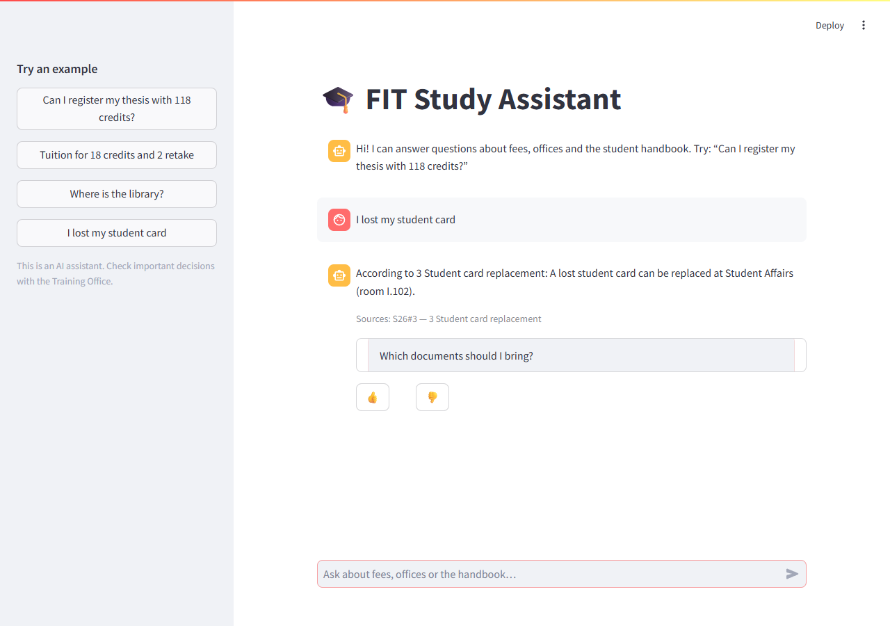

# H1 — 10-minute usability test

The observer confirmed a 10-minute session with a participant outside the team. The entries below paraphrase the observer’s account. The participant’s name and session date were not supplied.

**Task.** Find out whether a student with 118 credits can register for a thesis and where to replace a lost student card.

| What the participant did | What they expected | What caused the confusion |
|---|---|---|
| Read the 120-credit and GPA requirements and asked whether being two credits short ruled out registration even with sufficient GPA. | A direct answer for 118 credits. | The answer quoted the general rule and left the comparison to the student. |
| Clicked H26#5.3 and then asked where to find section 5.3. | To open the cited handbook section. | The citation appeared as a caption without a link. |
| Found room I.102 and clicked 👎 to explain that the answer omitted which documents to bring. After the confirmation, they looked for somewhere to type. | To explain what was missing when rating the answer. | The vote was submitted immediately and the controls disappeared. |

## Change made

Each answer now offers an optional comment before the rating buttons. The UI sends the comment and the selected rating together using the existing feedback API. A failed submission keeps the text available for retry.

### Before

### After

